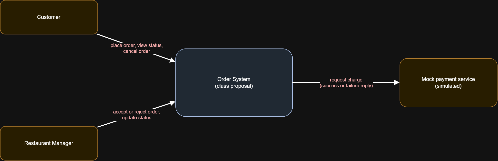
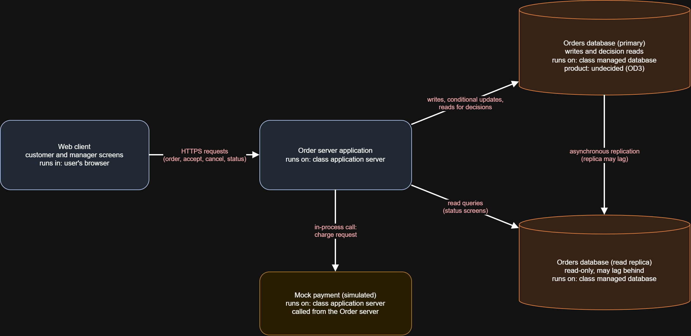
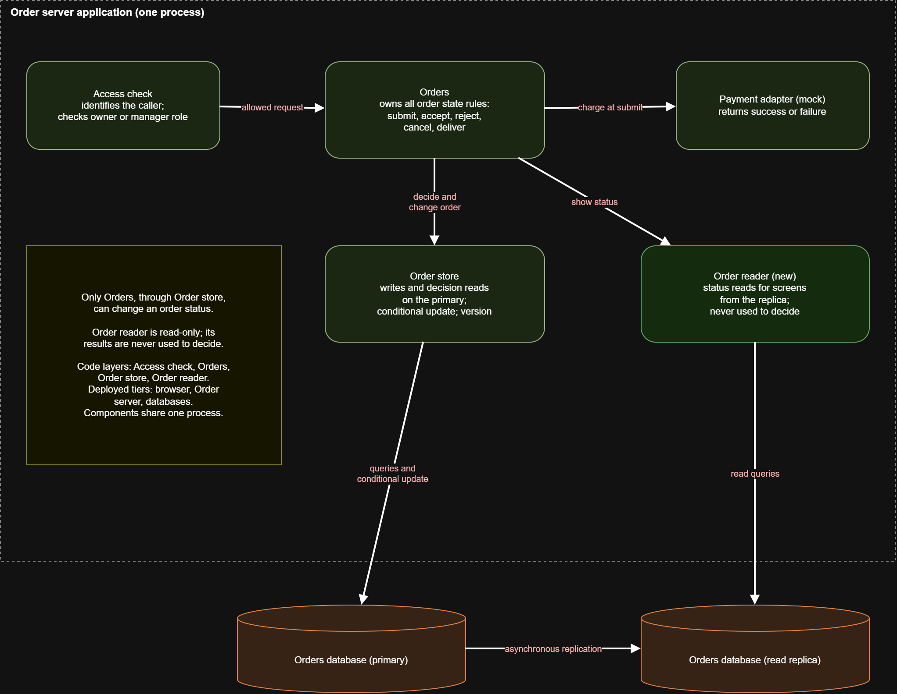
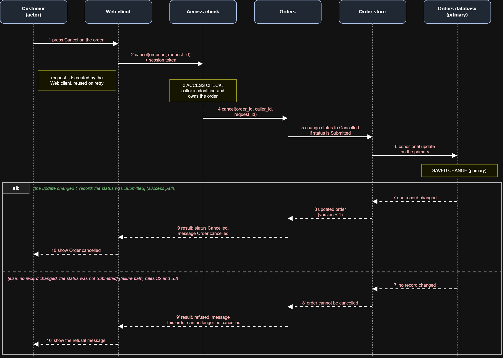

# Food-Ordering SaaS: Specification, Architecture and Test Plan

A design-only course project for **CS391 Software Engineering** (Faculty of Computers and Information, Assiut University, 2026). It follows one feature of a food-delivery application (cancel a submitted order) from the user need to the specification, the architecture and the test plan.

> **Status:** specification, architecture and test plan only. There is **no source code** in this repository, and none of the planned tests has been run yet. This is a class proposal, not the architecture of any real company.

## What the project covers

| Stage | What was produced |
|---|---|
| Requirements | The feature, actors, scope and key terms; one world assumption; one requirement; 3 rules written as "When [event], if [condition], the system must [observable response]"; one measurable quality target (95% of cancellation responses within 2 seconds with 20 concurrent users) |
| Architecture | 4 draw.io diagrams: context, applications, components, and a sequence diagram with a success path and a failure path |
| Decisions | 2 architecture decision records: where acceptance and cancellation are decided (one modular server), and where status reads go (read replica for screens, primary for decisions) |
| Risks and tests | 3 planned risk tests (competing requests, lost response, old replica result) and a plan to measure the quality target. All marked "Not run" |
| Project management | 12 issues in Linear linked from requirements to release, with dependencies, owners and one accepted change request |

## The feature in short

A customer can cancel an order only while its status is `Submitted`. Once the restaurant has accepted, rejected or delivered the order, or it is already cancelled, the system refuses the cancellation and leaves the status unchanged. When a cancellation and an acceptance arrive for the same order, only one change wins.

## Architecture (class proposal)

* A web client talks to one modular order server over HTTPS.
* The server has five components: Access check, Orders, Order store, Order reader, Payment adapter (mock).
* Only the Orders component changes an order status, through one conditional update on the primary database.
* Status screens read from a read replica, and every decision (cancel, accept) reads and writes only the primary.

See the editable file `Kerollus-Lab4.drawio` (open it at https://app.diagrams.net).

### Context

### Applications

### Components

### Sequence

## Tools

Linear (project and issue tracking), draw.io (diagrams), the WRSPM model (specification).

## Author

Kerollus Adel. Individual work.
